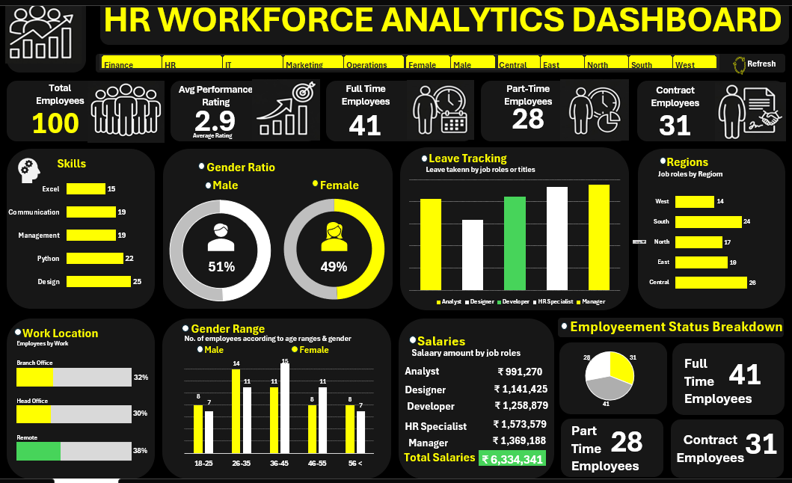

# HR Workforce Analytics Dashboard — Excel

## Project overview

This project is an interactive Human Resources (HR) workforce dashboard built in Microsoft Excel as a **guided learning project**. It brings several workforce summaries into one view and lets users explore the available metrics through dashboard filters/slicers.

The goal was to practise Excel dashboard construction, KPI presentation, chart selection, and interactive reporting—not to make causal claims about workforce outcomes.

## Dashboard preview

*The preview shows the dashboard with filters selected. KPI values in the screenshot reflect the current filter selection and should not be read as the unfiltered totals.*

## Workbook contents

Open `HR_Workforce_Analytics_Dashboard.xlsm` in desktop Microsoft Excel. The workbook contains these worksheets:

- **Dashboard** — visual summary with KPI cards, charts, and interactive filters.
- **Data** — source employee records.
- **Pivot** — supporting PivotTables and calculations used by the dashboard.

The source data sheet contains 100 employee records and 21 fields, including employee ID, gender, age, region, job title, department, hire date, employment status, work location, salary, pay grade, leave taken, performance rating, training, skills, and certifications.

## Dashboard areas

- Workforce count and performance-rating summary
- Employment status breakdown
- Gender and age-group distribution
- Salary by job role
- Work location and region
- Leave tracking and skills
- Interactive filtering across available categories

## Tools and techniques

- Microsoft Excel (`.xlsm` workbook)
- PivotTables and PivotCharts
- KPI cards and summary calculations
- Interactive filters/slicers
- Chart formatting, conditional formatting, and dashboard layout

Only use the workbook features that are present in the supplied file. Some Excel features may behave differently in other spreadsheet applications.

## How to use

1. Download `HR_Workforce_Analytics_Dashboard.xlsm`.
2. Open it in desktop Microsoft Excel and enable editing if prompted.
3. Go to the **Dashboard** sheet.
4. Use the available filters/slicers to explore the metrics.
5. Check the **Data** and **Pivot** sheets to inspect the underlying records and supporting summaries.

Because the file is macro-enabled, only enable macros if you trust the workbook source and have reviewed the file. The dashboard may work without enabling macros if the workbook's charts and slicers do not depend on them.

## Learning outcomes

Through this guided project, I practised:

- arranging multiple workforce metrics in one dashboard;
- choosing charts to present categories and distributions;
- using PivotTables/PivotCharts and interactive filtering;
- improving visual hierarchy, labels, and dashboard layout;
- connecting a dashboard to supporting data and summary worksheets.

## Limitations and interpretation

- This is a descriptive dashboard; it does not establish why a workforce pattern occurs or prove causal relationships.
- Metric interpretation depends on the source data and the calculation used. Check the workbook before relying on any KPI.
- The preview is filtered, so its displayed counts are not necessarily the totals for all 100 records.
- The source data's provenance and redistribution license have not been verified in this repository. Before making the repository public, confirm that the original dataset/tutorial permits redistribution. If not, remove the embedded data workbook from the public repository and provide the original source link and instructions instead.

## Attribution

- Dataset/source: **Add the original dataset URL and creator here.**
- Guided tutorial/project reference: **Add the tutorial title and URL here.**

Please complete these attribution fields and verify redistribution permissions before publishing publicly.

## Author

**Khushi Maurya**  
Aspiring Data Analyst | Excel | SQL | Power BI | Python

- LinkedIn: **Add your LinkedIn profile URL**
- GitHub: **Add your GitHub profile URL**
